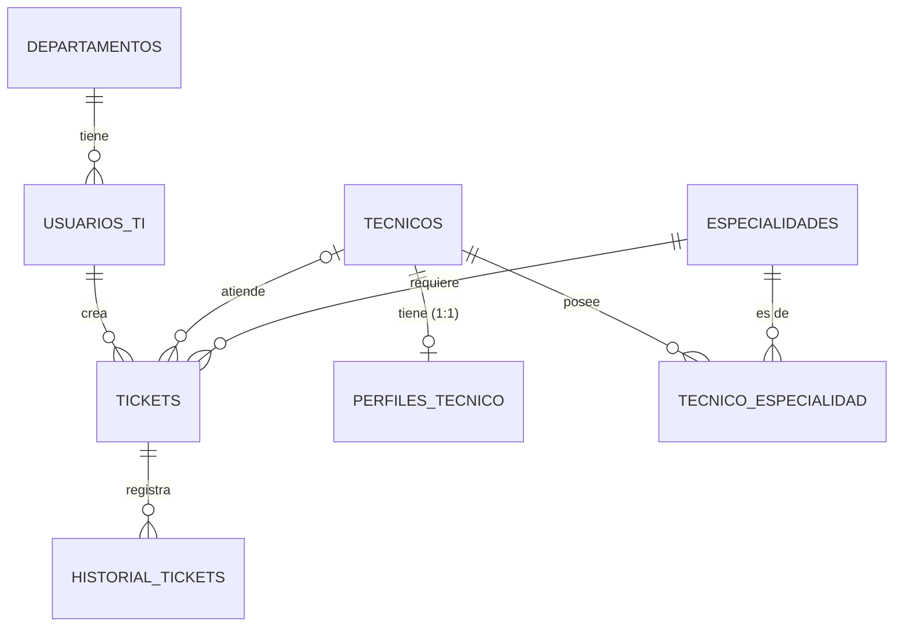

# 🎫 Sistema de Tickets de Soporte TI

**Estudiante:** _Escribe aquí tu nombre completo_
**Módulo:** Administración de Bases de Datos · Actividad de cierre

## Descripción del sistema
Aplicación de escritorio hecha con **Flet** y conectada a una base de datos relacional **MySQL/MariaDB** mediante **PyMySQL**. Permite registrar y administrar solicitudes de soporte técnico de una organización: quién las pide, qué técnico las atiende, qué especialidad requieren y cómo evolucionan en el tiempo.

## Problema que busca resolver
Cuando los problemas informáticos se piden por pasillo, WhatsApp o correo, se pierden solicitudes, no se sabe quién las atiende ni cuánto llevan abiertas, y se asignan a técnicos que no corresponden. Este sistema centraliza los tickets, valida las reglas de asignación y deja un historial automático de cada cambio.

## Principales funciones
- CRUD completo (registrar, consultar, modificar, eliminar) de **tickets, usuarios, técnicos, departamentos y especialidades**.
- **Búsqueda y filtros** (texto, estado, prioridad, departamento).
- **Asignación de técnicos** mediante un procedimiento almacenado que valida especialidad, estado y carga de trabajo.
- **Historial automático** de cada ticket, registrado por los procedimientos almacenados.
- **Panel de inicio** con resúmenes (consultas con `GROUP BY`).
- Mensajes de éxito, advertencia y error; la aplicación no se cierra ante fallos de base de datos.

## Tecnologías utilizadas
Python 3.10+ · Flet 0.28.3 · PyMySQL · python-dotenv · MySQL 8 / MariaDB · Git y GitHub

## Modelo de datos
8 tablas relacionadas (ver detalle en [docs/DER.md](docs/DER.md)):

| Relación | Tipo | Implementación |
|---|---|---|
| `tecnicos` ↔ `perfiles_tecnico` | **1:1** | La PK de `perfiles_tecnico` es también FK hacia `tecnicos` |
| `departamentos` → `usuarios_ti`, `usuarios_ti` → `tickets`, `tecnicos` → `tickets`, `especialidades` → `tickets` | **1:N** | Claves foráneas con `ON DELETE RESTRICT` |
| `tecnicos` ↔ `especialidades` | **N:M** | Tabla intermedia `tecnico_especialidad` con PK compuesta |
| `tickets` → `historial_tickets` | **1:N** | Llenada por los procedimientos almacenados |



**Lógica en la base de datos**
- **Procedimientos almacenados** (`database/02_procedimientos.sql`):
  - `sp_crear_ticket`: solo usuarios activos crean tickets y deja el primer registro del historial.
  - `sp_asignar_ticket`: valida técnico activo, especialidad (N:M) y carga máxima de 5 tickets en proceso.
  - `sp_cambiar_estado`: ciclo de vida (no reabrir cerrados, exigir técnico, completar `fecha_cierre`).
- **Sin triggers:** el servidor de la base de datos del colegio no otorga el privilegio `SUPER` (error 1419 con *binary logging* activo), por lo que no se pueden crear. Las reglas se aplican en los procedimientos y se refuerzan con restricciones `CHECK` en la tabla `tickets` (`chk_ticket_estado_tecnico`, `chk_ticket_fecha_cierre`).
- **Consultas** con `JOIN` y `GROUP BY`: `database/04_consultas.sql` y `app/db.py`.
- **Restricciones**: `PRIMARY KEY`, `FOREIGN KEY`, `UNIQUE`, `NOT NULL`, `CHECK`, `ENUM`.

## Cómo ejecutar el proyecto
1. Tener **MySQL o MariaDB** encendido (XAMPP, Laragon, etc.).
2. Clonar el repositorio y crear un entorno virtual:
   ```bash
   git clone <URL-de-tu-repositorio>
   cd soporte-ti-tickets
   python -m venv .venv
   .venv\Scripts\activate        # En Linux/Mac: source .venv/bin/activate
   pip install -r requirements.txt
   ```
3. Copiar `.env.example` como `.env` y completar usuario y contraseña de MySQL.
4. Crear la base de datos con sus tablas, trigger, procedimiento y datos de ejemplo:
   ```bash
   python init_db.py
   ```
   Usa la base indicada en `DB_NAME` (debe existir). El script crea las tablas y procedimientos; si ya existen las tablas del proyecto, pide confirmación antes de reemplazarlas. También puedes ejecutar los archivos de `database/` en orden desde DBeaver.
5. Iniciar la aplicación:
   ```bash
   python main.py
   ```

## Estructura
```
main.py            # Aplicación Flet (navegación)
init_db.py         # Crea la BD ejecutando database/*.sql
app/config.py      # Lee el .env
app/db.py          # Todas las consultas con PyMySQL
app/ui.py          # Componentes reutilizables
app/views/         # Pantallas: inicio, tickets, usuarios, técnicos, catálogos, historial
database/          # Esquema, procedimientos, datos de ejemplo y consultas
docs/              # DER y capturas
```

## Captura de la aplicación

