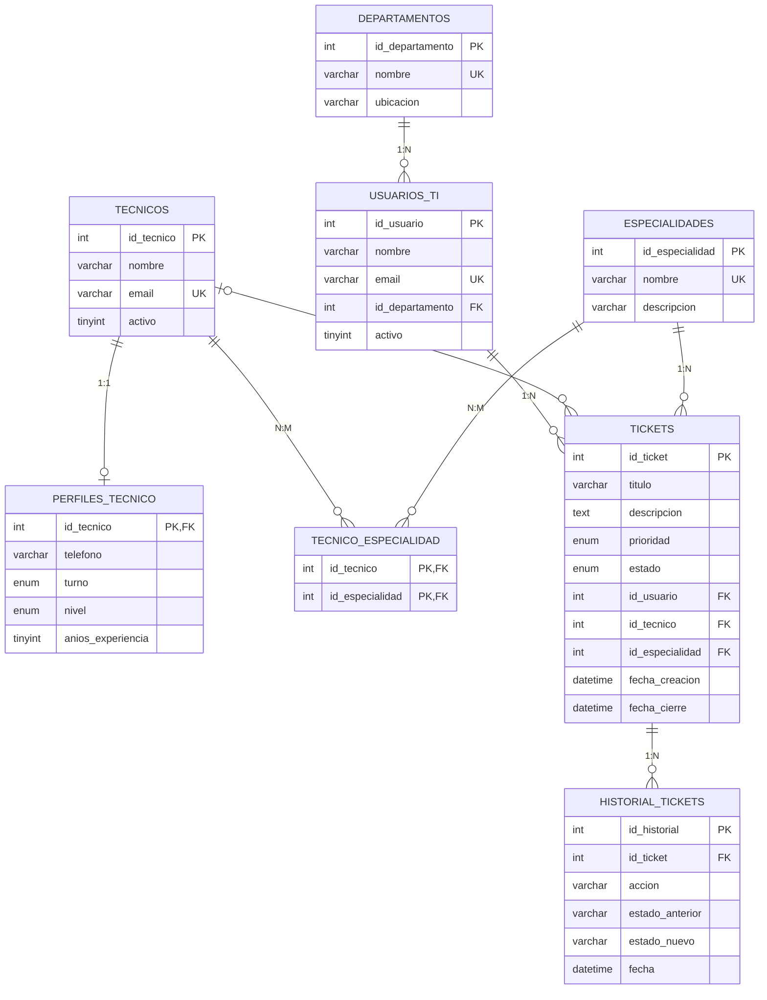

# Diagrama Entidad-Relación

## Reglas de negocio
- Un ticket cerrado no puede reabrirse (`sp_cambiar_estado`).
- Un ticket no puede estar En proceso, Resuelto o Cerrado sin técnico (`sp_cambiar_estado` y `CHECK` `chk_ticket_estado_tecnico`).
- `fecha_cierre` existe solo si el ticket está Resuelto o Cerrado (`CHECK` `chk_ticket_fecha_cierre`).
- Solo se asigna un técnico activo, con la especialidad del ticket y menos de 5 tickets en proceso (`sp_asignar_ticket`).
- Solo usuarios activos crean tickets (`sp_crear_ticket`).
- No se puede borrar un usuario, técnico, departamento o especialidad que tenga tickets asociados (`ON DELETE RESTRICT`); se desactiva.
